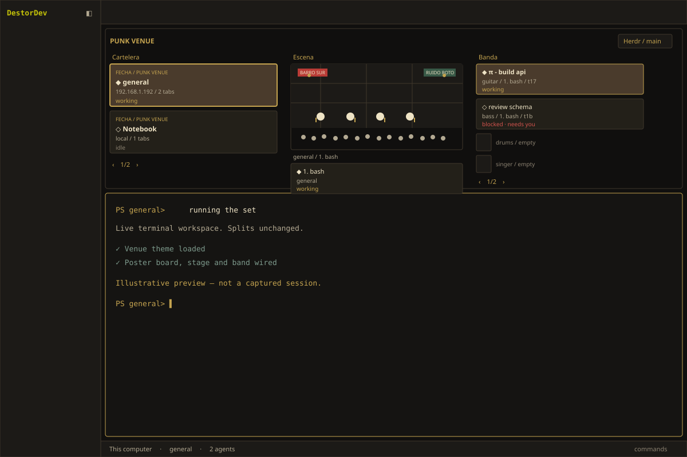

# Herdr punk-venue

A custom layout for the [Herdr](https://herdr.dev) desktop app: your coding agents play an Argentine punk gig. Each agent takes an instrument on stage, the front row is a crowd, and the venue fills with people waiting at the door when nothing is running.

```
punk-venue/
  layouts/   the window: three lanes (Cartelera, Escena, Banda)
  mods/      the mod that draws the gig, plus its generated art and tools
  themes/    the palette
```



## What you see

- **Cartelera** lists spaces as gig dates, **Banda** lists the band, and **Escena** is the stage.
- An agent that reports `working` plays: two poses trade places at 800 ms. `idle`, `done` and `blocked` stand still with their instrument.
- Empty positions keep their gear on stage, so the stage always reads as a venue.
- The front row sways out of phase and two cutouts bob over it.

## Install

Herdr treats `~/.config/herdr-app/AGENTS.md` as its contract: it redraws itself from those files while running, so copying a layout or a mod applies it live.

```sh
cp layouts/punk-venue.json   ~/.config/herdr-app/layouts/
cp -r mods/punk-venue        ~/.config/herdr-app/mods/
cp themes/punk-venue.json    ~/.config/herdr-app/themes/
```

Then check the mod and switch to it:

```sh
herdr-app check ~/.config/herdr-app/mods/punk-venue
herdr-app do layout.switch --name punk-venue
```

Keep this folder as the source of truth: the installed copy should stay byte-identical, except `gpui-kit.d.ts`, which the app rewrites on every start.

## Verify

- `herdr-app check <mod folder>` loads the mod once and validates its initial description. A passing check is necessary, not sufficient: it does not lay the mod out or run deferred rows.
- `powershell -File mods/punk-venue/tools/validate.ps1` regenerates the art and diffs it against what is shipped: 78 SVGs, exact filename inventory, six-colour palette, the 4:1 scene and 8:1 crowd aspect ratios, head and fist heights, layer order, and every preserved SHA-256. It writes only in system temp.
- `node --test mods/punk-venue/tools/queue-walk.test.mjs` pins the entrance animation lifecycle; `node --test mods/punk-venue/tools/banner-layout.test.mjs` covers the banner typesetting.
- `herdr-app shot <file.png>` captures the window for visual proof.

## Notes that cost build iterations

- Keep the shipped coupling IDs (`sidebar`, `tabs`, `main`, `panel`, `panel-body`, `files`, `changes`). A layout that renames them breaks the mods it reuses.
- `image()` fits by aspect ratio, so scene art must match its box ratio; everything aligns to a computed art rect, not to the box.
- Native `.loop` runs only while its element is drawn. Prefer it over `cx.timer`; the one timer here drives the entrance walkers and is gated on the shown layout, the active space and a render lease.
- Editing a mod's `main.js` hot-reloads the render but does not re-run `init`, so one-time async work must also start lazily from `render`.
- A node painted earlier in a container chain is covered by later children: overlay a sign as a sibling painted after the scene.
- On Windows the system draws no window buttons, so a root `"titlebar": "none"` without a bar mod leaves the window with no controls.
- All art is generated by `mods/punk-venue/tools/generate.mjs`. Change the generator and regenerate; a hand-edited SVG fails the validator's regeneration check.
